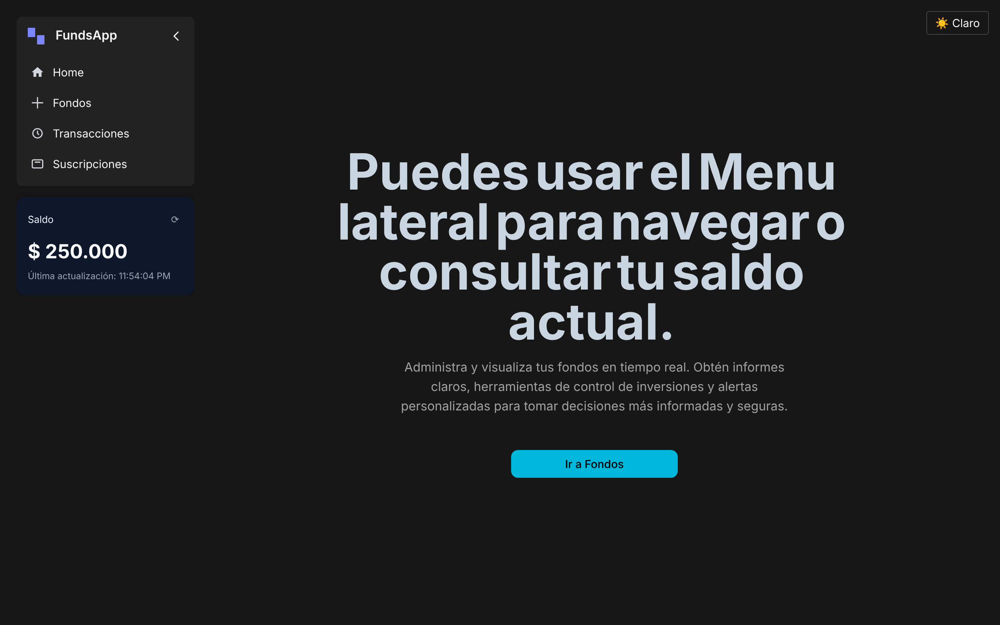
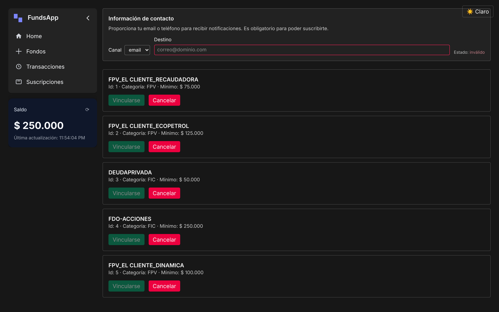
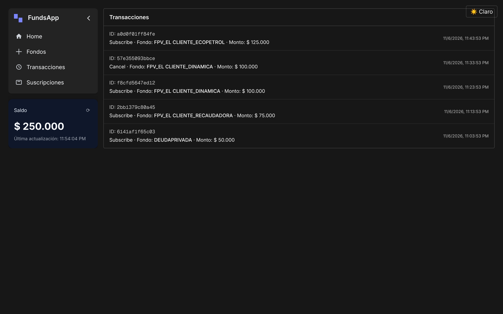
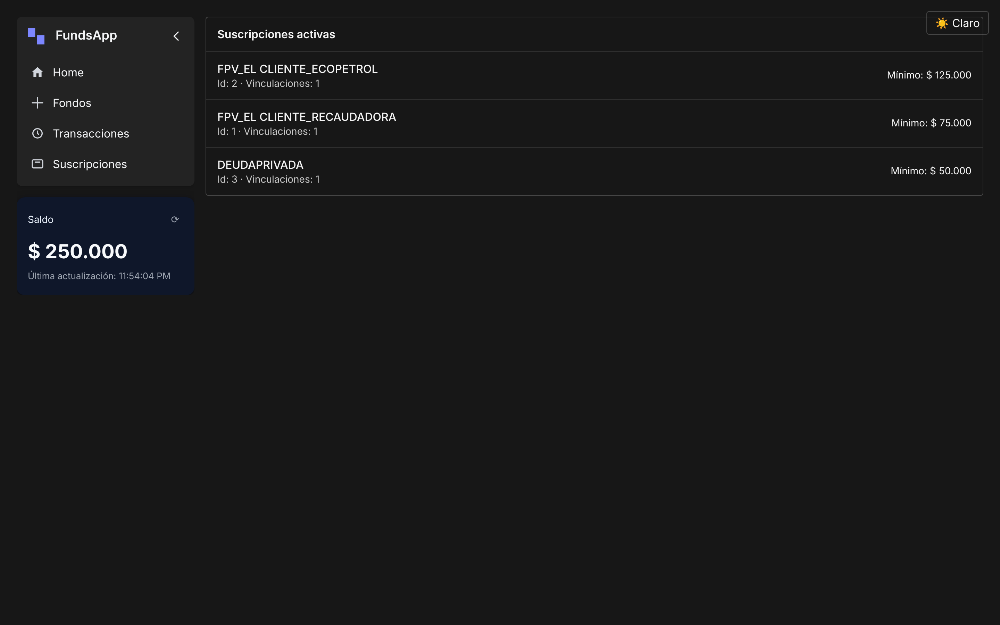
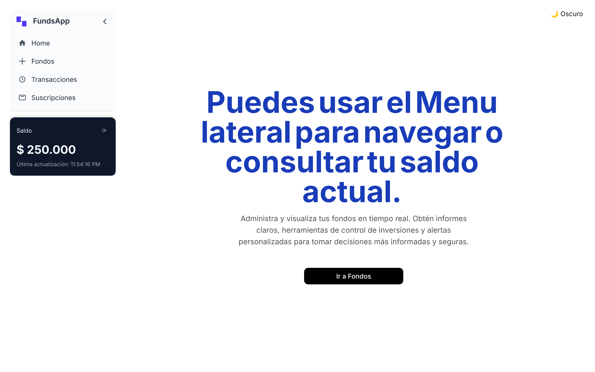
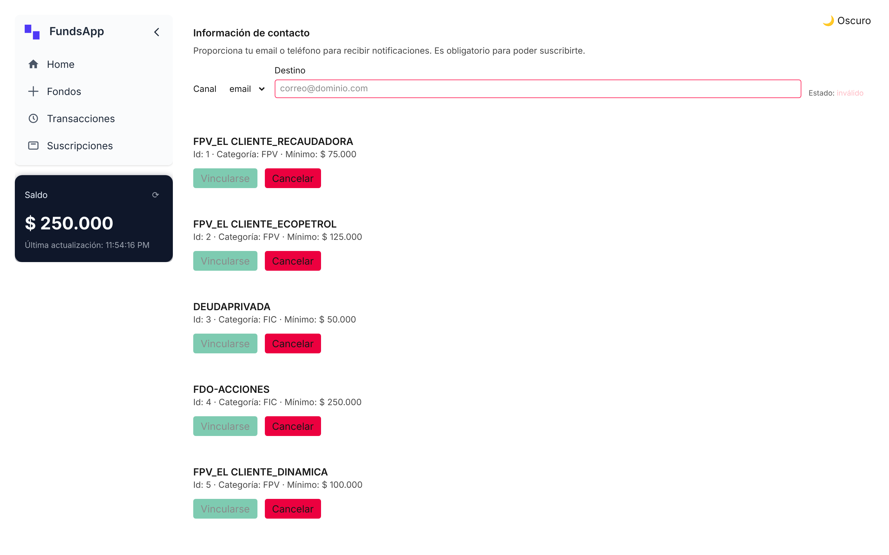
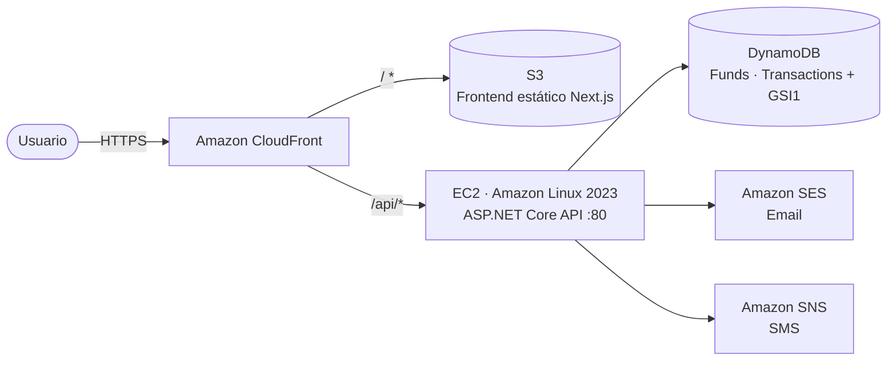

<div align="center">

# 💼 FundsApp — Gestión de Fondos de Inversión en AWS

Plataforma para que un cliente consulte su saldo, se **vincule** o **cancele** fondos de inversión (FPV / FIC), revise su historial de transacciones y reciba notificaciones por **email** o **SMS**.


**[🌐 Demo en vivo](https://dvsvnp7nbzde3.cloudfront.net/)**

</div>

> [!NOTE]
> Las notificaciones por email usan **Amazon SES en modo sandbox**: solo se entregan a direcciones verificadas en la cuenta AWS del autor. El resto de la aplicación funciona con normalidad.

---

## 📑 Tabla de contenido

- [Capturas de pantalla](#-capturas-de-pantalla)
- [Funcionalidades](#-funcionalidades)
- [Arquitectura](#-arquitectura)
- [Stack tecnológico](#-stack-tecnológico)
- [Estructura del repositorio](#-estructura-del-repositorio)
- [API REST](#-api-rest)
- [Modelo de datos en DynamoDB](#-modelo-de-datos-en-dynamodb)
- [Ejecución local](#-ejecución-local)
- [Pruebas](#-pruebas)
- [Despliegue en AWS](#-despliegue-en-aws)
- [Solución de problemas](#-solución-de-problemas)
- [Consulta SQL (parte 2 de la prueba)](#-consulta-sql-parte-2-de-la-prueba)

---

## 📸 Capturas de pantalla

| Inicio | Fondos disponibles |
|:---:|:---:|
|  |  |
| **Historial de transacciones** | **Suscripciones activas** |
|  |  |

<details>
<summary><b>Tema claro</b></summary>

| Inicio | Fondos |
|:---:|:---:|
|  |  |

</details>

---

## ✨ Funcionalidades

- **Saldo en tiempo real** — saldo inicial de **COP $500.000**, recalculado a partir del historial de transacciones.
- **Catálogo de fondos** — 5 fondos sembrados automáticamente al iniciar la API:

  | Id | Fondo | Monto mínimo | Categoría |
  |:--:|---|--:|:--:|
  | 1 | FPV_EL CLIENTE_RECAUDADORA | $75.000 | FPV |
  | 2 | FPV_EL CLIENTE_ECOPETROL | $125.000 | FPV |
  | 3 | DEUDAPRIVADA | $50.000 | FIC |
  | 4 | FDO-ACCIONES | $250.000 | FIC |
  | 5 | FPV_EL CLIENTE_DINAMICA | $100.000 | FPV |

- **Vinculación (apertura)** — descuenta el monto mínimo del saldo; si no alcanza responde
  `No tiene saldo disponible para vincularse al fondo <Nombre del fondo>`.
- **Cancelación** — devuelve el monto de la vinculación al saldo del cliente.
- **Historial de transacciones** — cada operación genera un identificador único, tipo, fondo, monto y fecha.
- **Notificaciones** — por email (Amazon SES) o SMS (Amazon SNS), según la preferencia del usuario.
- **UI responsiva** con menú lateral colapsable y **tema claro / oscuro**.

---

## 🏗 Arquitectura



- **CloudFront** sirve el frontend desde S3 (Origin Access Identity) y enruta `/api/*` hacia la instancia EC2, evitando contenido mixto y problemas de CORS.
- **EC2** ejecuta la API como servicio `systemd`; su rol IAM permite acceso a DynamoDB, lectura del artefacto en S3 y SSM.
- Toda la infraestructura se define como código en **AWS CloudFormation** (`infra/cloudformation.json`).

### Capas del backend (Clean Architecture)

```
API  ──▶  Infrastructure  ──▶  Core
│          │                    └─ Entidades de dominio (Fund, Transaction)
│          ├─ Services: FundsService, SESEmailSender, SNSNotificationSender
│          ├─ Repositories: DynamoDB + In‑Memory (intercambiables por configuración)
│          └─ Startup: DynamoBootstrapper (crea tablas y siembra datos)
└─ Controllers, middleware global de excepciones, DI y CORS
```

---

## 🧰 Stack tecnológico

| Capa | Tecnologías |
|---|---|
| Backend | .NET 9, ASP.NET Core Web API, AWS SDK for .NET (DynamoDB, SES, SNS) |
| Frontend | Next.js 15 (static export), React 19, TypeScript, Tailwind CSS 4, Framer Motion, lucide-react |
| Datos | Amazon DynamoDB (single-table design con GSI) |
| Infraestructura | CloudFormation, EC2, S3, CloudFront, IAM, SES, SNS |
| Pruebas | xUnit |
| Automatización | Scripts PowerShell 7 para build, publicación y despliegue |

---

## 📂 Estructura del repositorio

```
aws-eshop/
├── API/                      # ASP.NET Core Web API (controllers, middleware, Program.cs, Dockerfile)
├── Core/                     # Entidades de dominio
├── Infrastructure/           # Servicios, repositorios DynamoDB/In-Memory, bootstrapper
├── Tests/FundsService.Tests/ # Pruebas unitarias (xUnit)
├── Client/funds/             # Frontend Next.js
│   └── src/{app,components,services,dtos,lib}
├── infra/                    # CloudFormation + scripts de despliegue (PowerShell)
├── docs/screenshots/         # Capturas usadas en este README
├── postman_collection.json   # Colección Postman de la API
└── aws-eshop.sln
```

---

## 🔌 API REST

Base: `/api/funds`

| Método | Endpoint | Descripción | Body |
|:--:|---|---|---|
| `GET` | `/api/funds` | Lista los fondos disponibles | — |
| `GET` | `/api/funds/balance` | Saldo actual del cliente | — |
| `POST` | `/api/funds/subscribe` | Vincula al cliente a un fondo | `{ "fundId": "1", "notifyChannel": "email", "notifyDestination": "user@mail.com" }` |
| `POST` | `/api/funds/cancel` | Cancela la vinculación a un fondo | `{ "fundId": "1" }` |
| `GET` | `/api/funds/transactions?count=10` | Últimas *N* transacciones | — |

**Respuestas**

| Código | Caso |
|:--:|---|
| `200` | Operación exitosa → `{ "transactionId": "..." }` |
| `400` | Regla de negocio violada (p. ej. saldo insuficiente) → `{ "message": "..." }` |
| `404` | Fondo inexistente → `{ "message": "Fondo X no existe" }` |
| `500` | Error no controlado (manejado por `ExceptionHandlingMiddleware`) |

Puedes probarla con `API/API.http` o importando `postman_collection.json` en Postman.

---

## 🗄 Modelo de datos en DynamoDB


### Esquema general
- Claves primarias: `PK` (string), `SK` (string)
- Índice secundario global `GSI1`: `GSI1PK` (string), `GSI1SK` (string)

### Entidades

| Entidad | PK | SK | GSI1PK / GSI1SK | Atributos |
|---|---|---|---|---|
| **Usuario** (perfil / saldo) | `USER#{UserId}` | `PROFILE` | — | `Balance`, `ContactChannel` (`email` \| `sms`), `ContactDestination`, `CreatedAt` |
| **Fondo** (catálogo) | `FUND#{FundId}` | `METADATA` | `FUND` / `Category#{Category}#Name` | `Name`, `MinAmount`, `Category` (`FPV` \| `FIC`) |
| **Suscripción** activa | `USER#{UserId}` | `SUB#{FundId}` | `USER#{UserId}#SUB` / `FundName` | `FundId`, `FundName`, `Amount`, `SubscribedAt`, `Status` |
| **Transacción** | `USER#{UserId}#TX` | `{TimestampTicks}#{TxId}` | — | `TxId`, `Type` (`Subscribe` \| `Cancel`), `FundId`, `FundName`, `Amount`, `TimestampUtc` |

### Patrones de acceso

| Caso de uso | Operación |
|---|---|
| Obtener fondo por id | `GetItem(PK=FUND#{FundId}, SK=METADATA)` |
| Listar fondos | `Query` en `GSI1` con `GSI1PK="FUND"` |
| Filtrar por categoría | `Query` en `GSI1` + `begins_with(GSI1SK, "Category#FPV")` |
| Consultar saldo | `GetItem(PK=USER#{UserId}, SK=PROFILE)` |
| Historial | `Query(PK=USER#{UserId}#TX, ScanIndexForward=false, Limit=N)` |

### Atomicidad con `TransactWriteItems`

**Suscribir**
1. `ConditionCheck` sobre `FUND#{FundId}/METADATA` (existe; leer `MinAmount`).
2. `ConditionCheck` → `attribute_not_exists(SK)` en `SUB#{FundId}` (no duplicar).
3. `Update` del perfil: `SET Balance = Balance - :min` con `ConditionExpression Balance >= :min`.
4. `Put` de `SUB#{FundId}` (`Status = "Active"`).
5. `Put` del registro `TX`.

**Cancelar**
1. `ConditionCheck` → `SUB#{FundId}` existe y `Status = "Active"`.
2. `Update` del perfil: `SET Balance = Balance + :amount`.
3. `Delete` de `SUB#{FundId}` (o `Status = "Cancelled"` para histórico).
4. `Put` del registro `TX`.

---

## 💻 Ejecución local

### Requisitos
- [.NET SDK 9](https://dotnet.microsoft.com/download)
- Node.js 18+ y npm
- (Opcional) Credenciales AWS si quieres usar DynamoDB real

### 1. Backend

Para ejecutar sin AWS, activa los repositorios en memoria:

```bash
cd API
UseInMemoryFunds=true UseInMemoryTransactions=true dotnet run
# API en http://localhost:5087
```

O con DynamoDB real (usa tus credenciales AWS por defecto y `AWS:Region` de `appsettings.json`):

```bash
cd API
dotnet run
```

Claves de configuración relevantes (`API/appsettings.json`):

| Clave | Default | Descripción |
|---|---|---|
| `AWS:Region` | `us-east-1` | Región de DynamoDB / SES / SNS |
| `InitialBalance` | `500000` | Saldo inicial del cliente |
| `UseInMemoryFunds` | `false` | Catálogo de fondos en memoria |
| `UseInMemoryTransactions` | `false` | Transacciones en memoria |
| `Notifications:Enabled` | `false` | Activa el envío de notificaciones |
| `Notifications:Provider` | `sns` | `ses` (email) o `sns` (SMS) |

### 2. Frontend

```bash
cd Client/funds
npm install
NEXT_PUBLIC_API_BASE=http://localhost:5087 npm run dev
# http://localhost:3000
```

> En producción `NEXT_PUBLIC_API_BASE` se deja vacío para que el frontend use rutas relativas (`/api/*`) a través de CloudFront.

### Docker (API)

```bash
docker build -f API/Dockerfile -t funds-api .
docker run -p 8080:8080 -e UseInMemoryFunds=true -e UseInMemoryTransactions=true funds-api
```

---

## 🧪 Pruebas

```bash
dotnet test Tests/FundsService.Tests
```

Casos cubiertos por `FundsServiceTests`:
- Saldo inicial por defecto
- Listado delegado al repositorio
- Suscripción: descuenta saldo, registra transacción y notifica
- Error cuando el fondo no existe
- Error por saldo insuficiente

---

## ☁️ Despliegue en AWS

### Recursos aprovisionados
- **EC2** (Amazon Linux 2023) ejecutando la API como servicio `systemd` en el puerto 80
- **DynamoDB**: tablas `Funds` y `Transactions` (con `GSI1`)
- **S3** para el frontend estático + **CloudFront** con OAI
  - `/` → S3 · `/api/*` → EC2 (caché deshabilitada)
- **SNS** / **SES** para notificaciones
- **IAM** role / instance profile para EC2

### Prerrequisitos
- Cuenta AWS con permisos sobre IAM, EC2, DynamoDB, S3, CloudFront, SNS y SES
- AWS CLI v2 configurado (`aws configure` o un perfil con `-Profile`)
- PowerShell 7+ (`pwsh`), .NET SDK 9, Node.js 18+

### 1) Compilar y empaquetar la API

```powershell
cd API
dotnet publish -c Release -r linux-x64 /p:PublishSingleFile=true /p:IncludeAllContentForSelfExtract=true --self-contained true -o ..\publish\api
cd ..
Compress-Archive -Force -Path .\publish\api\* -DestinationPath .\publish\funds-api.zip

aws s3 mb s3://your-artifact-bucket-us-east-1 --region us-east-1
aws s3 cp .\publish\funds-api.zip s3://your-artifact-bucket-us-east-1/artifacts/funds-api.zip --region us-east-1
```

### 2) Elegir VPC y subred pública
En la consola de AWS → VPC: copia el **VPC ID** y el **Subnet ID** de una subred pública (para que la instancia reciba IP pública).

### 3) Desplegar la infraestructura

```powershell
pwsh -NoProfile -File .\infra\deploy-stack.ps1 `
  -StackName FundsAppStack `
  -VpcId vpc-xxxxxxxx -SubnetId subnet-xxxxxxxx `
  -ArtifactBucket your-artifact-bucket-us-east-1 `
  -ArtifactKey artifacts/funds-api.zip `
  -AwsRegion us-east-1 -TopicEmail you@example.com
```

Parámetros opcionales: `-Environment`, `-KeyName`, `-InstanceType` (auto-selecciona tipos free-tier), `-ImageId`, `-NotificationsProvider` (`ses`/`sns`), `-FromEmail`, `-Profile`, `-PreferredAz`.

**Outputs del stack**
- `PublicURL` — DNS público de EC2 (HTTP)
- `FrontendBucketName` — bucket S3 del frontend
- `FrontendDomainName` — dominio de CloudFront

En el primer arranque la API crea las tablas de DynamoDB y siembra los 5 fondos. Los logs de la instancia se suben a `s3://<ArtifactBucket>/logs/<instance-id>/`.

### 4) Publicar el frontend

```powershell
pwsh -NoProfile -File .\infra\publish-frontend.ps1 -StackName FundsAppStack -AwsRegion us-east-1
```

Compila `Client/funds` como export estático, sincroniza `out/` con S3 e invalida CloudFront. Abre `https://<FrontendDomainName>`.

### 5) Actualizaciones
- **Backend**: repetir pasos 1 y 3 (también disponible `infra/deploy-api.ps1` / `infra/publish-api.ps1`).
- **Frontend**: repetir paso 4.

### Limpieza
Elimina el stack `FundsAppStack` en CloudFormation y el bucket de artefactos si lo creaste por separado.

> Para un dominio propio: emite un certificado en **ACM (us-east-1)** y apunta tu dominio a la distribución de CloudFront con **Route 53**.

---

## 🛠 Solución de problemas

| Síntoma | Solución |
|---|---|
| `AccessDenied` en la raíz de CloudFront | Verifica que `index.html` exista en el bucket; vuelve a ejecutar `publish-frontend.ps1`. |
| Error de *mixed content* | No uses `NEXT_PUBLIC_API_BASE=http://EC2...`; deja la base relativa para que CloudFront haga proxy de `/api/*` por HTTPS. |
| `500` o `AccessDenied` de DynamoDB | Revisa el rol IAM de EC2 y que existan las tablas. Consulta los logs en S3. |
| Sin datos | La API siembra en el primer arranque; reinicia el servicio vía SSM o redepliega. |
| Cambios no visibles | La invalidación de CloudFront puede tardar unos minutos; fuerza un *hard refresh*. |
| No llegan emails | SES en sandbox: verifica el correo destino en SES o solicita salir del sandbox. |

---

## 🧮 Consulta SQL (parte 2 de la prueba)

> Obtener los clientes que tienen inscrito algún producto disponible **solo** en las sucursales que visitan.

```sql
SELECT c.id, c.nombre, c.apellidos
FROM cliente c
JOIN inscripcion i     ON i.idCliente  = c.id
JOIN disponibilidad d  ON d.idProducto = i.idProducto
LEFT JOIN visitan v
       ON v.idSucursal = d.idSucursal
      AND v.idCliente  = c.id
GROUP BY c.id, c.nombre, c.apellidos
HAVING COUNT(*) = COUNT(v.idSucursal);  -- ninguna sucursal que ofrece el producto queda sin visitar
```

`COUNT(*)` cuenta todas las sucursales donde están disponibles los productos del cliente, y `COUNT(v.idSucursal)` solo las que el cliente visita; si coinciden, todas las sucursales ofertantes son visitadas por él.

---

<div align="center">

Hecho con ❤️ por **[GEKKOLAS](https://github.com/GEKKOLAS)**

</div>
